# checkAll and CI timing (2026-11-28)

Measured to find which stage is worth shortening next. This document records
numbers only. No build config or workflow was changed.

## How it was measured

- Local: `./gradlew checkAll -Pmin_free_disk_gb=5 --console=plain`, with each
  output line prefixed by the wall-clock time, on an Apple M2 Pro (10 cores, 16 GB) at commit `a1b21fea4`. The free-disk guard was lowered on
  purpose because the volume had 19.9 GB free. The run stopped at the start of
  `gameTestAll` (the session ended), so `gameTestAll` was measured afterwards
  with `./gradlew gameTestAll` on the same checkout, same machine, built
  outputs already present from the first run. Treat its total as slightly
  optimistic relative to a single `checkAll` run.
- CI: step timestamps from `gh run view --json jobs` for a `ci.yml` pull
  request run (2026-11-27, run 46058033483, 3m18s in total), a `ci.yml` push run
  on main (46024618094) and one `nightly.yml` scheduled run (46047688060).
  Only one sample each, so differences of a few seconds are noise.

## checkAll (local, all versions)

| Stage | Wall time | Share |
| --- | --- | --- |
| `verifyFormalModels` (TLC, 2 models, before `cleanAll`) | under 10 s | 1% |
| `cleanAll` and 17 `validate*` tasks (3 s or less each) | 19 s | 2% |
| `buildAll` with unit tests | 7 m 28 s | 55% |
| `gameTestAll` | 5 m 25 s | 40% |
| Total | about 13 m 20 s, plus Gradle start | |

### buildAll (3 versions at a time, `maxParallel = 3`)

Per-version time inside the parallel run (`build/build-<version>.log`):

| Version | Time | Version | Time |
| --- | --- | --- | --- |
| 1.20.1 | 1 m 47 s | 1.21.8 | 1 m 32 s |
| 1.21.1 | 1 m 44 s | 1.21.9 | 1 m 38 s |
| 1.21.2 | 1 m 48 s | 1.21.10 | 1 m 34 s |
| 1.21.4 | 1 m 31 s | 1.21.11 | 1 m 35 s |
| 1.21.5 | 1 m 45 s | 26.1.2 | 1 m 11 s |
| 1.21.6 | 1 m 42 s | 26.2 | 59 s |
| 1.21.7 | 1 m 34 s | 26.3 | 51 s |

The sum is 21 m 11 s and the wall time is 7 m 28 s, so about 2.8 versions ran
at once. Versions are uniform (about 1.5 to 1.8 minutes for 1.20.1 to 1.21.11,
under 1.2 minutes for 26.x), so no single version dominates.

### gameTestAll (2 groups at a time, `maxParallel = 2`)

Per-group time (`build/gametest-<version>.log`, Fabric and NeoForge in one
Gradle process):

| Group | Time | Group | Time |
| --- | --- | --- | --- |
| 1.20.1 (Fabric only) | 41 s | 1.21.8 | 37 s |
| 1.21.1 | 40 s | 1.21.9 | 37 s |
| 1.21.2 and 1.21.3 | 43 s + 1 m 37 s | 1.21.10 | 40 s |
| 1.21.4 | 43 s | 1.21.11 | 39 s |
| 1.21.5 | 29 s | 26.1.2 | 36 s |
| 1.21.6 | 27 s | 26.2 | 38 s |
| 1.21.7 | 43 s | 26.3 | 23 s |

The sum is about 10 m 10 s and the wall time is 5 m 25 s (about 1.9 at once).
The 1.21.2 plus 1.21.3 pair runs in sequence and takes about 2 m 20 s, the
longest single unit. The 1.21.3 run (1 m 37 s) is about twice the 1.21.2 run
(43 s) on the same modules, and the reason was not investigated. In CI the
Fabric run takes about 60 s and the NeoForge run about 30 s for the same
version (cause not investigated).

## CI (ci.yml, one pull request run, 3 m 18 s)

```mermaid
gantt
    dateFormat HH:mm:ss
    axisFormat %M:%S
    section serial prefix
    changes (docs-only detect) :a1, 19:37:44, 13s
    validate                   :a2, 19:38:00, 37s
    section parallel jobs
    build 26.3 (and 1.21.1)    :b1, 19:38:40, 96s
    gametest 1.21.1 / 26.3     :b2, 19:38:40, 119s
    prod-smoke 1.21.1 / 26.3   :b3, 19:38:40, 138s
```

| Job | Duration | Main step |
| --- | --- | --- |
| changes (docs-only detect) | 13 s | checkout 8 s |
| validate | 37 s | `validateAll` 17 s, `verifyFormalModels` 4 s, setup about 12 s |
| build and unit test 1.21.1 / 26.3 | 1 m 23 s / 1 m 36 s | `./gradlew build` 68 s / 66 s |
| GameTest 1.21.1 / 26.3 | 1 m 59 s | Fabric 63 s, NeoForge 30 s |
| prod-smoke 1.21.1 / 26.3 | 2 m 12 s / 2 m 18 s | Fabric 74 to 80 s, NeoForge 34 to 42 s |

- Every matrix job waits for `validate` (`needs: [changes, validate]`), and
  `validate` waits for `changes`. The serial prefix before the matrix starts is
  about 59 s of the 3 m 18 s total (30%).
- Past the prefix, the critical path is prod-smoke (up to 2 m 18 s). Each
  job's own setup (set up job, checkout, setup-java, setup-gradle) is 6 to 25 s
  and repeats in all seven jobs, but they run in parallel so it only costs
  runner minutes, not wall time.
- The push run on main (46024618094) has the same shape: 3 m 31 s in total,
  prod-smoke 1.21.1 the slowest at 2 m 32 s.

## nightly.yml (one scheduled run, 4 m 16 s)

Twelve version jobs run at once, each is setup (about 15 to 25 s) plus
`./gradlew build` (2 m 5 s for 26.1.2, 3 m 36 s for 1.21.2). The wall time is
the slowest jobs (1.21.5, 1.21.8, 1.21.2, 1.21.6, 3 m 35 s to 3 m 41 s of build each). Nothing to
shorten cheaply: the cost is in builds that are already parallel per version.

## Shortening candidates

Estimates are upper bounds taken from the numbers above, not measurements of a
change.

| # | Candidate | Affects | Expected saving | Risk or open point |
| --- | --- | --- | --- | --- |
| 1 | Start the CI build, GameTest and prod-smoke jobs without waiting for `validate` (and run `changes` only where needed) | CI wall time of every PR | up to about 50 s of 3 m 18 s (about 25%) | Invalid PRs spend runner minutes on jobs that would have been skipped. Needs a decision on fail-fast versus speed |
| 2 | Raise `gameTestAll` `maxParallel` from 2 to 3 (`gradle/shared/multi-version-tasks.gradle`) | `checkAll`, `gameTestAll` | up to about 2 m of 5 m 25 s (613 s / 3 = 204 s) | Memory on a 16 GB machine (a GameTest JVM per group), and the 1.21.2 plus 1.21.3 pair stays a 2 m 20 s floor. The submodule is shared, so the change goes through `gradle/shared` |
| 3 | Raise `buildAll` `maxParallel` from 3 to 4 | `checkAll`, `buildAll`, `release` | up to about 2 m 10 s of 7 m 28 s (1271 s / 4 = 318 s) | Same memory limit, plus concurrent writes to the shared Gradle cache. Return may be small because the effective parallelism is already 2.8 of 3 |

Not worth doing now: the `validate*` tasks (19 s in total), `verifyFormalModels`
(8 s), and the nightly (already one job per version).

## Result: `buildAll` `maxParallel` 3 to 4 (not adopted)

One run of `./gradlew buildAll -Pbuildall_run_tests=true` with `maxParallel = 4`
(`gradle/shared/multi-version-tasks.gradle`) on the same Apple M2 Pro (10 cores,
16 GB) took 10 m 21 s and all 14 versions passed, with no "Could not store
compilation result" in the per-version logs. The baseline above with
`maxParallel = 3` is 7 m 28 s, so 4 was about 2 m 50 s slower, not the up to
2 m 10 s faster that the estimate allowed.

- The run was the only one: a second run was not possible because free disk
  fell to 10 GB, under the 20 GB `min_free_disk_gb` limit. The baseline may also
  have had warmer caches, so the gap is a hint and not a proven cost of 4.
- The likely cause is the 16 GB memory limit (four JVMs plus daemons) and I/O
  contention, on top of the effective parallelism being already 2.8 of 3. This
  was not confirmed by a memory measurement.
- Decision: keep `maxParallel = 3`. No change to `gradle/shared`.
